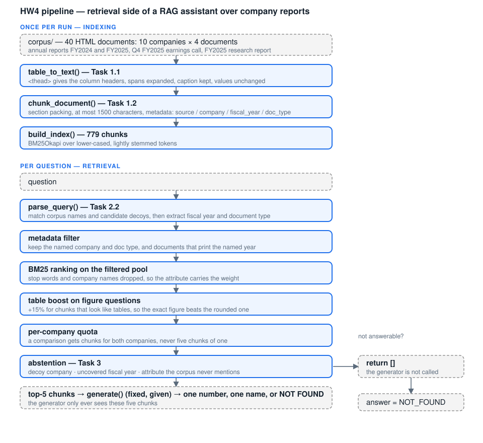

# FTEC5660-HW4

The retrieval half of a RAG assistant over company reports: parse the HTML and its tables, chunk
with metadata, understand the question, retrieve at most five chunks, and abstain when the library
cannot answer. The five graded functions live in `hw4.py` (`table_to_text`, `chunk_document`,
`parse_query`, `build_index`, `retrieve`); the provided code below them is untouched.

```bash
python3 -m venv .venv && source .venv/bin/activate
pip install -r requirements.txt
echo "DEEPSEEK_API_KEY=your_key_here" > .env
python3 hw4.py --data-folder public_test               # the five tasks
python3 ablation.py --data-folder public_test          # Task 5, Tasks 1-3
python3 ablation.py --data-folder public_test --with-llm --markdown   # also Task 4
```

| File | What it is |
|---|---|
| `hw4.py` | the five functions and their helpers, followed by the provided code |
| `ablation.py` | Task 5 harness: B0 plus one variant per added component |
| `pipeline.svg` | the figure below |
| `results.csv` | the runner's output, one row per question |
| `ablation.csv` | aggregate ablation results |
| `ablation_answers.csv` | generated answers and correctness by variant and question |

---

## Homework 4 solution



**Pipeline.** The parser expands HTML table spans and writes each row with its column labels, preserving captions, units and printed values. The chunker packs text and table rows by section into chunks of at most 1,500 characters, with source, company, fiscal year and document type derived from the document. The index uses BM25 with lowercase regex tokens and light stemming. The query parser matches known names and looks for plausible unfamiliar company names so a missing company can trigger abstention. Retrieval filters by company, document type and covered fiscal year before ranking. It removes common question words and company names from the scoring query, boosts table-heavy chunks for numeric questions and reserves slots for each company in a comparison. It returns no chunks when a named company is missing, the requested year is outside coverage, or an informative term is absent from the corpus.

### Ablation study

B0 uses BeautifulSoup text, recursive character splitting, required metadata and BM25 top five with lowercase whitespace tokens. Each successive row changes one component. The last variant uses the same retriever as the graded runner. The public-set results below were generated with `ablation.py --with-llm --markdown`. The aggregate scores are in `ablation.csv` and the per-question answers and correctness flags are in `ablation_answers.csv`.

| Variant | Change | 1.1 | 1.2 | 2.1 | 2.2 | 2.3 | 3 | 4 | Total 1-4 | recall@5 | top-1 | both sides |
|---|---|---|---|---|---|---|---|---|---|---|---|---|
| B0 | naive RAG: get_text(), RecursiveCharacterTextSplitter(), BM25 top-5, never [] | 0.00 | 7.00 | 5.00 | 0.00 | 0.00 | 0.00 | 9.33 | 21.33 | 30.4% | 17.6% | 41.7% |
| V1 | + table_to_text replaces the number soup of get_text() | 8.00 | 7.00 | 5.00 | 0.00 | 0.00 | 0.00 | 9.67 | 29.67 | 32.6% | 20.6% | 33.3% |
| V2 | + section-aware chunking with a section header | 8.00 | 7.00 | 5.00 | 0.00 | 0.00 | 0.00 | 7.33 | 27.33 | 23.9% | 11.8% | 41.7% |
| V3 | + parse_query metadata filtering (company, year, doc type) | 8.00 | 7.00 | 5.00 | 10.00 | 14.67 | 7.14 | 18.33 | 70.15 | 89.1% | 41.2% | 100.0% |
| V4 | + regex tokenization and light stemming for BM25 | 8.00 | 7.00 | 5.00 | 10.00 | 11.41 | 7.14 | 17.33 | 65.89 | 80.4% | 50.0% | 100.0% |
| V5 | + stop words and company names dropped from the BM25 query | 8.00 | 7.00 | 5.00 | 10.00 | 15.00 | 7.14 | 20.00 | 72.14 | 100.0% | 79.4% | 100.0% |
| V6 | + table boost for questions that ask for a figure | 8.00 | 7.00 | 5.00 | 10.00 | 15.00 | 7.14 | 20.00 | 72.14 | 100.0% | 88.2% | 100.0% |
| V7 | + one quota per company so a comparison gets both sides | 8.00 | 7.00 | 5.00 | 10.00 | 15.00 | 7.14 | 20.00 | 72.14 | 100.0% | 88.2% | 100.0% |
| V8 | + lexical abstention for absent terms | 8.00 | 7.00 | 5.00 | 10.00 | 15.00 | 10.00 | 20.00 | 75.00 | 100.0% | 88.2% | 100.0% |

Recall@5 measures complete evidence coverage over the 46 answerable questions. Top-1 refers to the 34 single-evidence questions. Both sides measures company coverage over the 12 comparisons.

- **V1, table conversion.** Preserving row and column labels earns the eight table-scoring points. Recall moves from 30.4% to 32.6%, a change of one question.
- **V2, section-aware chunks.** Section boundaries change which text BM25 scores together. Recall falls to 23.9% before metadata filtering, so cleaner chunk boundaries alone do not solve document selection.
- **V3, metadata filtering.** Recall rises from 23.9% to 89.1%, and correct generated answers rise from 22 to 55 out of 60. Company and fiscal-year filtering keeps similarly named issuers and irrelevant reporting periods out of the candidate pool.
- **V4, regex tokens and stemming.** Top-1 rises from 41.2% to 50.0%, while recall falls from 89.1% to 80.4%. Token normalization changes rankings but leaves distracting common terms in the query.
- **V5, query cleanup.** Removing common question terms and issuer names lets the financial attribute carry more weight. Recall reaches 100.0% and correct generated answers rise from 52 to 60.
- **V6, table boost.** Top-1 improves from 79.4% to 88.2%. Exact table figures move ahead of rounded prose more often, with no change in recall.
- **V7, company quotas.** Both-side coverage stays at 100%. The quotas reserve room for both companies when one would otherwise dominate the ranking.
- **V8, lexical abstention.** The additional check catches four unanswerable questions and retains all 46 answerable ones. Task 3 rises from 7.14 to 10.00. The final variant and the separate runner both score 60/60 on Task 4.

### Error analysis

The final system retrieves complete evidence for all 46 answerable public questions, but the first chunk misses the evidence on q008, q009, q015 and q024. For example, the audit-firm question q015 ranks a different governance subsection ahead of the relevant evidence. Ranking matters when multiple passages contain plausible names or figures.

The unfamiliar-company fallback relies on name capitalization and wording. It correctly handles an unfamiliar company such as Orion Aerospace and abstains when a comparison names both a known company and an absent company. The lexical answerability check is also sensitive to paraphrase. In q033, “single” is the absent token that triggers refusal, so rephrasing the same question can change the decision. Prior-year questions may use a later report with two year columns, so the generator must use the requested column even when the report metadata names another year.

The separate graded runner took 7.9 seconds on this recorded run, including 0.4 seconds for indexing and 0.1 seconds for retrieval. Retrieval itself made zero LLM calls.

---

## Task 6: Reflection

Written for the world the question imagines, where ten years from now everyone has a personal agent
that can write, program, research, run a business and make sophisticated decisions. I have tried to
answer from this assignment rather than from what I would like to believe about myself.

**What kind of person would you want to be in that world?**

The person who is still trusted to say what is true. Building this homework made that concrete in a
way that reading about it never did. The language model was never the problem: it was fixed, given to
me, and it answered correctly nearly every time it was handed the right passage. Everything that went
wrong went wrong upstream — in what reached it, under which header, from which fiscal year. That
rearranged my sense of where a person is still needed. In ten years I do not want to be the person
with the best prompts. I want to be the person whose "that number is wrong" is believed without
argument, because I have a habit of having checked.

**Which of your current ambitions would still matter?**

The ambition to understand the thing rather than to have produced it. There was a moment in this
assignment when retrieval recall rose from about 24% to 89% with metadata filtering, and I could have stopped at the
numbers. What mattered — the part I will still remember in a year — was discovering that the jump
came from deciding which documents were eligible *before* ranking them, because no tokenisation can
separate "Northgate Robotics" from "Northgate Payments", or 2024 from 2025, when both words appear in
almost every document. An agent can hand me a working configuration. It cannot hand me that
understanding, and the understanding is what will still be worth something.

My ambitions about a specific market and specific people survive too, only with different content. A
wrong number in a Hong Kong or mainland research report is not an abstraction: it has a client, a
portfolio and a name attached to it. That has not changed, and it will not change because the writing
of the report got cheaper.

**What would you want to be known for beyond your productivity and professional achievements?**

For judgment about what is worth doing, and for being straight about what I do not know. The small
version of this happened in the ablation table above. The honest table says that a carefully built
table-to-text function earned its eight points and improved retrieval by just one question, and that one
deliberately designed component — the per-company quota — changed no number at all. A tidier narrative
was available; with enough enthusiasm any component can be made to look load-bearing. I wrote the
version where two rows sit flat, because that is what the measurement said. It is the smallest
possible rehearsal for a much larger habit, and I would rather be known for the habit than for the
table.

**What are you willing to struggle for, even when an AI agent could make the struggle unnecessary?**

The slow version of things. Reading the annual report instead of a summary of the annual report.
Deriving a number by hand once before trusting anything that produces it a thousand times. Writing a
bad first draft and then repairing it. Not out of nostalgia. The ability to check a machine's output
comes from having done the work the machine now does, and this assignment gave me a specific
demonstration: my abstention rule looks principled, but one of the questions it correctly refuses is
refused only because a single word in it happens to be absent from the whole corpus. I found that by
following one question out of sixty, not by reading the score. Nothing but the slower habit would
have made me look.

**What skills, qualities, or experiences would still make you valuable?**

Three, and only the first is a skill in the ordinary sense. Knowing what "correct" means in a
particular domain — in finance, which numbers must reconcile, where a rounding convention hides a real
difference, which two figures cannot both be true. The ability to evaluate rather than to produce:
choosing what to vary and what to hold fixed, and reading a perfect score with suspicion rather than
relief. And accountability, which is not a capability at all, and is precisely the thing that cannot
be delegated to an agent that has nothing at stake in being right.

**If your value is no longer determined primarily by what you can do, how will you define who you are?**

By what I choose to attend to, by what I refuse, and by who I am responsible for. An agent will answer
any question I can type, so the questions I type are the part that is mine — they are the only thing in
the loop that has a reason behind it. I notice that all seven questions here are versions of this one,
and that none of them can be answered by being more productive, which I find reassuring rather than
frightening.

**What should you start doing differently tomorrow?**

Three things, small enough that I will actually do them. Write the prediction down *before* running
the experiment: in this assignment I changed a component and then looked at which number moved, which
is hindsight wearing the costume of design. Keep a failure log: the two discoveries I am proudest of
came from chasing single wrong questions — the possessive that swallowed three words into a company
name, and the fiscal-year window that is the only reason an FY2023 question can be answered at all —
not from staring at an aggregate. And say plainly which part of a piece of work is mine and which part
I outsourced. Part of this reflection was drafted in conversation with an AI agent, and so, partly, was
the code above, and I would rather say so than hide it. What is mine is the standard the work is held
to: every number in the report can be re-derived from the repository, and signing it means being able
to defend every line of it, which is the only honest test I can set myself for work I did not type out
by hand. That division of labour will be ordinary within a few years, and being open about it now is
what keeps a signature worth anything.
